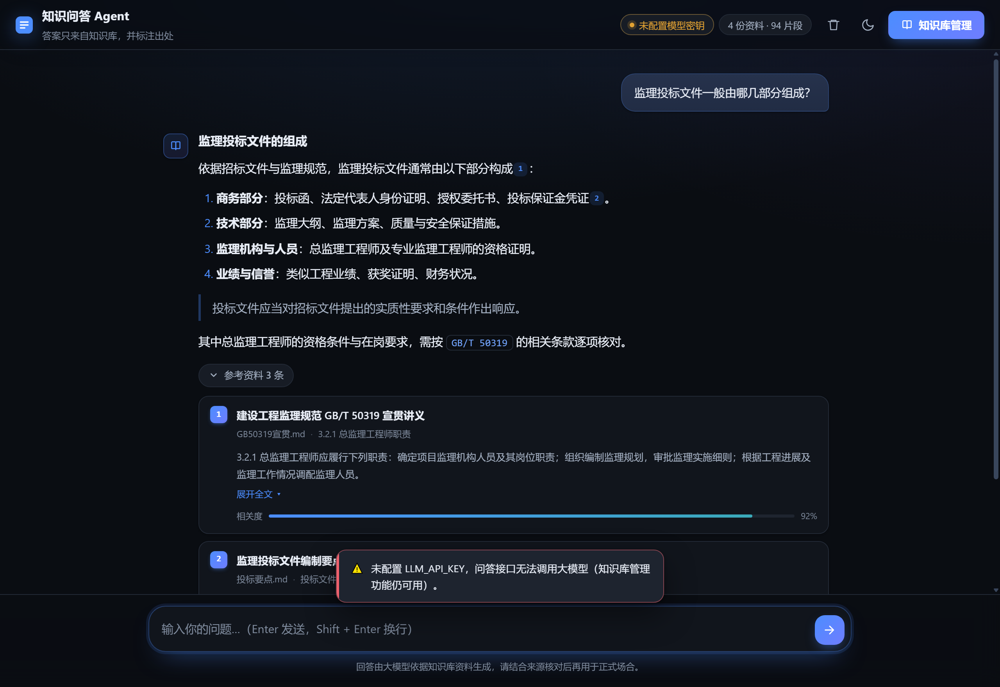
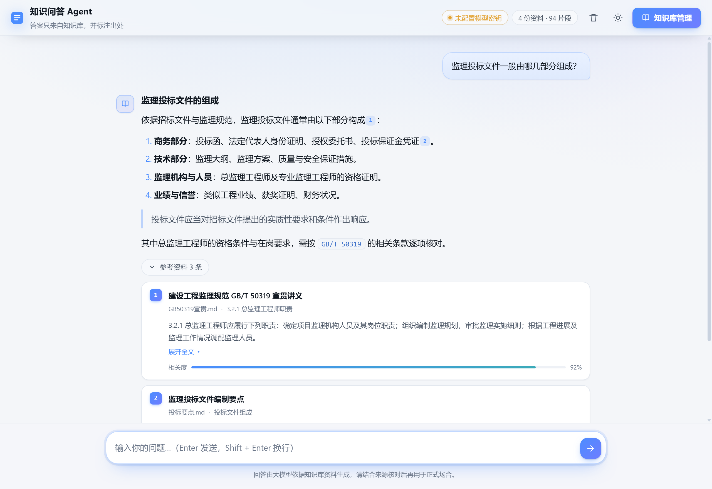
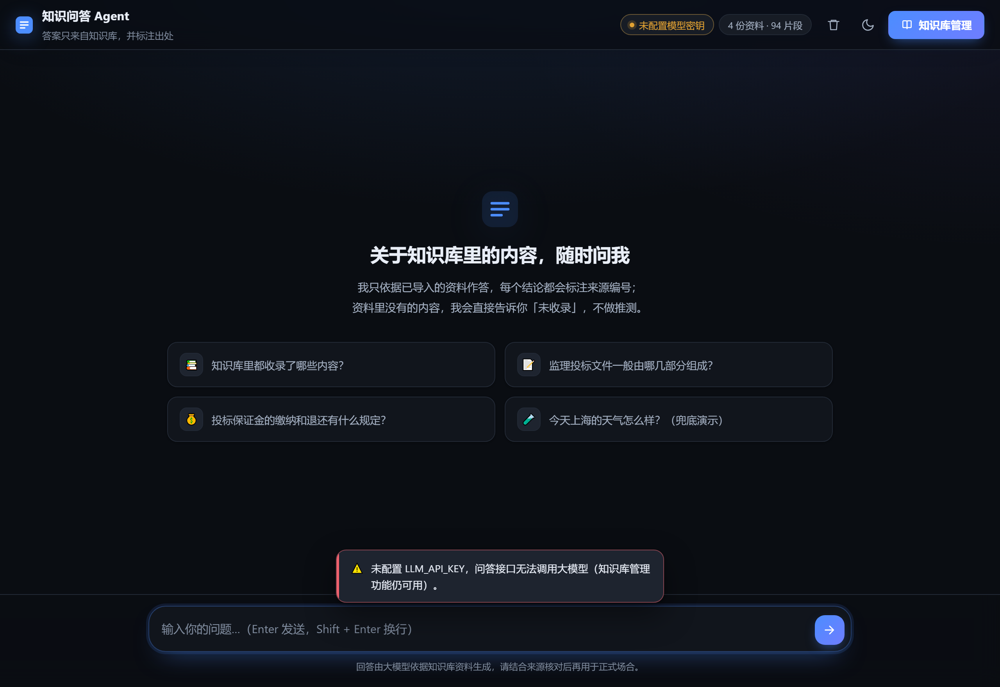
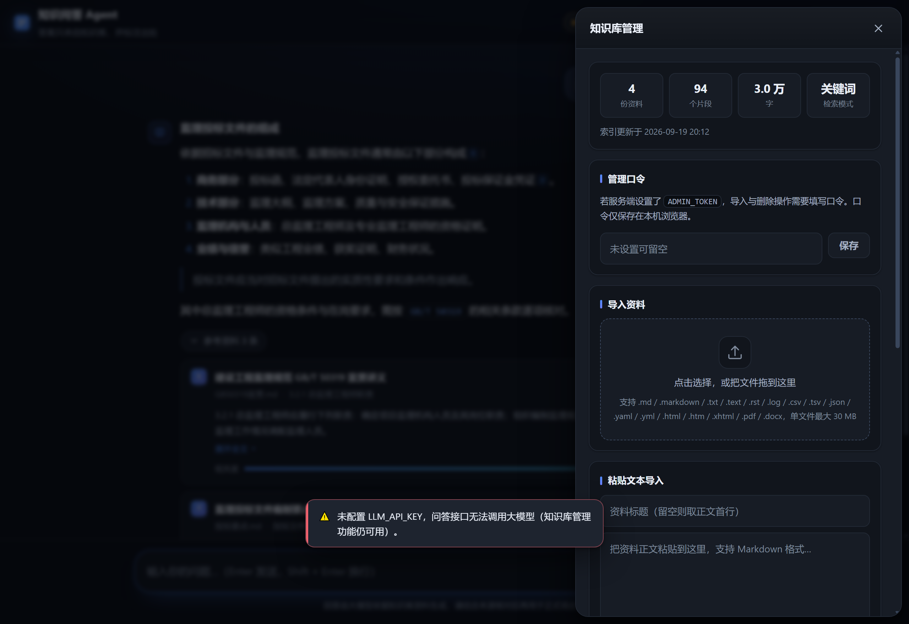
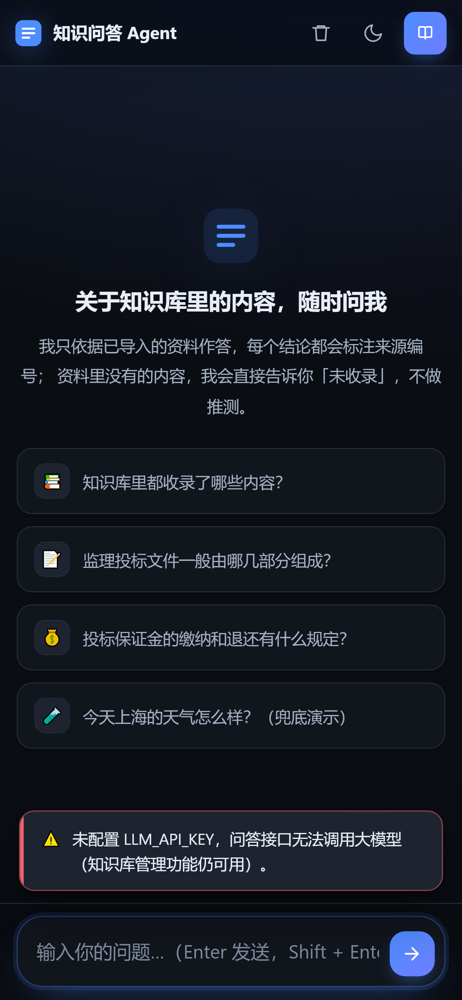
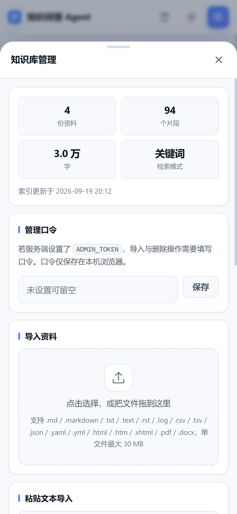

# 知识问答 Agent

基于私有知识库的**检索增强（RAG）问答 Web 应用**。用户用自然语言提问，系统先在知识库中检索相关资料，
再让大模型**仅依据检索到的资料**作答，并在答案中标注来源编号；知识库没有覆盖的问题会明确兜底提示，
不做编造。

---

## 一、核心特性

| 能力 | 实现方式 |
| --- | --- |
| 问答界面 | 原生 HTML/CSS/JS，无构建步骤；桌面与移动端响应式，支持明暗主题 |
| 流式回答 | SSE 逐字推送，首字响应快；可随时点「停止」中断 |
| 知识库检索 | **混合检索**：BM25（中文 bigram 分词）+ 向量余弦，RRF 融合排序；**标题（章节路径）参与打分** |
| 可降级 | 未配置向量模型时自动降级为纯 BM25 关键词检索，**零强制外部依赖** |
| 来源标注 | 答案中的 `[1]` `[2]` 为可点击角标，跳转并高亮对应资料卡片，含原文摘录与相关度 |
| 三层防编造 | 检索闸门 → 提示词强约束 → 输出后处理剔除越界引用 |
| 兜底回复 | 覆盖率低于阈值直接兜底，**不调用大模型**；并告知知识库已覆盖的范围 |
| 知识库管理 | 页面上传（拖拽/点选）、粘贴文本、单份删除、增量更新、重建索引、生成向量 |
| 多格式解析 | `.md` `.markdown` `.txt` `.pdf` `.docx` `.html` `.csv` `.json` `.yaml` 等 |
| 开箱可用 | 附带 3 份示例资料，首次启动自动建索引，无需配置即可跑通全流程 |

---

## 界面预览

| 桌面端 · 暗色 · 问答 | 桌面端 · 亮色 · 问答 |
| --- | --- |
|  |  |
| **桌面端 · 暗色 · 欢迎页** | **桌面端 · 暗色 · 知识库管理** |
|  |  |
| **移动端 · 暗色 · 欢迎页** | **移动端 · 亮色 · 知识库管理** |
|  |  |

> 以上截图由 headless Chrome 对真实运行实例渲染所得，非设计稿。

---

## 二、目录结构

```
知识问答agent/
├── server/                     # 后端（Node.js + Express，无框架魔法）
│   ├── index.js                # 服务入口：中间件、路由挂载、启动自检
│   ├── config.js               # 统一配置层（读 .env）
│   ├── tokenizer.js            # 中文分词：CJK 单字 + bigram
│   ├── chunker.js              # Markdown 标题感知切分，带重叠
│   ├── loaders.js              # 多格式文本提取（PDF/DOCX 为可选依赖）
│   ├── store.js                # 索引持久化：BM25 统计 + 向量二进制
│   ├── indexer.js              # 入库编排：扫描 / 解析 / 切分 / 向量化
│   ├── retriever.js            # 混合检索 + RRF 融合 + 覆盖率闸门
│   ├── llm.js                  # OpenAI 兼容客户端（流式对话 / Embedding）
│   ├── answer.js               # 提示词组装、流式生成、兜底话术
│   └── routes/
│       ├── chat.js             # POST /api/chat（SSE）、POST /api/search
│       └── kb.js               # 知识库管理与鉴权
├── public/                     # 前端（无构建）
│   ├── index.html
│   ├── styles.css
│   └── app.js                  # 流式消费、Markdown 安全渲染、来源卡片、管理抽屉
├── knowledge/                  # 知识库源文件（种子资料，可换成你自己的）
├── data/                       # 运行时数据（索引 / 向量 / 上传件），勿提交 Git
├── scripts/
│   ├── reindex.js              # 命令行重建索引
│   ├── doctor.js               # 环境自检：配置 / 索引 / 检索闸门 / 模型连通性
│   ├── smoke.js                # HTTP 冒烟测试：打全部接口，含知识库增删往返
│   ├── check-frontend.js       # 前端静态交叉校验：元素 id / el 引用 / 本地资源 / hidden 兜底
│   ├── check-cmd-encoding.js   # 两个 .cmd 是否保持纯 ASCII（无中文、无 BOM）
│   ├── test-retriever.js       # 检索层回归，含"有向量/无向量"两条路径
│   ├── test-guard.js           # 扫描件守卫的真阳性 / 真阴性用例
│   ├── verify-hybrid.js        # 用真实 embedding 服务实测混合检索全链路
│   ├── test-cmd-encoding.js    # 上述 .cmd 校验的变异测试
│   ├── run-cmd-probe.js        # 实跑 .cmd 并按 GBK 解码输出（排查脚本故障用）
│   └── service.js              # 端口 / 进程探测，供两个 .cmd 启停脚本调用
├── python-rag/                 # 检索逻辑的 Python 复刻版，与 Node 版逐位对账一致
├── docs/screenshots/           # README 中的界面截图
├── 20260918RAG技术学习教程.html  # 11 章 RAG 教学材料，以本项目源码为教材
├── Dockerfile
├── docker-compose.yml
├── .env.example
├── 启动服务.cmd                # Windows 双击启动（自动开浏览器，关窗口即停服）
└── 停止服务.cmd                # Windows 一键停止
```

---

## 三、本地运行

### 1. 环境要求

- **Node.js ≥ 18.17**（推荐 20 或 22）
- 无需数据库、无需 Python、无需编译工具链

### 2. 安装与配置

```bash
# 进入项目目录
cd 知识问答agent

# 安装依赖
npm install

# 生成配置文件
cp .env.example .env        # macOS / Linux
copy .env.example .env      # Windows CMD
# PowerShell: Copy-Item .env.example .env
```

打开 `.env`，**至少填写一项**——大模型密钥：

```ini
LLM_BASE_URL=https://api.deepseek.com/v1
LLM_API_KEY=sk-你的DeepSeek密钥
LLM_MODEL=deepseek-chat
```

> DeepSeek 密钥在 <https://platform.deepseek.com/api_keys> 申请。
> 本项目的模型调用走 OpenAI 兼容协议，换成通义千问、智谱、Kimi、OpenAI 或本地 vLLM/Ollama
> 只需改这三个变量，代码无需改动。

> **`LLM_MODEL` 要按你的端点实际可用的名字填。** 并非所有端点都有 `deepseek-chat`，
> 而填错模型名时部分端点**不报错**，只会静默路由到默认模型，让人误以为配置生效。
> 先查一下真实可用的模型名：
>
> ```bash
> curl -H "Authorization: Bearer sk-你的密钥" https://api.deepseek.com/models
> ```

### 3. 启动

**Windows 日常使用：直接双击项目根目录的 `启动服务.cmd`。**

它会自动打开浏览器，窗口保持打开即服务运行，关掉窗口即停止服务。
若服务已在运行，它会显示占用端口的进程号并帮你打开页面，不会重复启动。
要停止服务，双击 `停止服务.cmd`（会列出并结束监听该端口的进程）。

两个脚本都不含中文（纯 ASCII），并把端口解析、`netstat` 解析交给
`scripts/service.js`——端口自动跟随 `.env`，且用**完整端口**匹配，
不会把 `18899` / `88990` 误认成本服务。

> **本机部署端口为 `8899`**（`8787` 已被其它平台占用）。
> 若 8899 后续也被占用，**只需改 `.env` 的 `PORT`** ——
> 两个 `.cmd` 启停脚本会通过 `scripts/service.js` 自动读取 `.env` 的端口，
> 不再硬编码；`scripts/smoke.js` 同样自动读取。改完重启服务即可。
> 查端口占用：`netstat -ano | findstr LISTENING | findstr ":8899"`

> ⚠️ **两个 `.cmd` 脚本必须保持纯 ASCII**（不含中文、不含全角标点）。
> 原因：`cmd.exe` 按系统 ANSI 代码页（中文 Windows = GBK）解码 `.cmd` 文件，
> 与文件实际编码无关；中文注释若以 UTF-8 存储会被解码成乱码，导致 `rem`
> 失效、`for /f` 的引号被撑破、整段脚本解析崩溃（现象：运行后满屏
> `'xxx' 不是内部或外部命令`）。`chcp 65001` 救不了这个问题。
> 改完请跑 `npm run test:cmd` 校验。

命令行方式（跨平台）：

```bash
npm start
```

看到下面的输出即表示就绪：

```
  ✅ 服务已就绪：http://localhost:8899
```

浏览器打开 <http://localhost:8899> 即可提问。

首次启动会自动扫描 `knowledge/` 目录并建立索引（无需任何手动操作）。

> **注意服务进程的生命周期。** 环境变量只在进程启动时读取一次，
> 因此改完 `.env` 必须重启服务才生效。Docker 部署时要用
> `docker compose up -d --force-recreate`（普通的 `restart` 不会重新读取 `.env`）。

### 4. 开发模式（改代码自动重启）

```bash
npm run dev
```

### 5. 环境自检

在交付给同事或上线之前，建议跑两遍：

```bash
npm run doctor            # 静态自检：配置 / 索引 / 检索闸门 / 模型连通性
npm run doctor -- --full  # 追加端到端问答实测（会真实调用大模型）
npm run smoke             # 服务需已启动。打一遍全部 HTTP 接口
npm run check:frontend    # 前端元素 id 与静态资源引用交叉校验（无需启动服务）
npm run test:guard        # 扫描件侦测的正反用例（无需启动服务）
npm run test:retriever    # 检索层回归，含"有向量/无向量"两条路径
npm run verify:hybrid     # 用真实 embedding 服务实测混合检索全链路（消耗极少额度）
```

也可以一条命令全跑：

```bash
npm run check             # check:frontend + test + doctor + smoke
```

`check:frontend` 解决的是前端最常见的静默故障：`app.js` 里用 `$('#xxx')` 取元素，
一旦 id 拼错或 HTML 里删了元素，页面只会控制台报错、功能失灵，肉眼很难发现。
这个脚本在不开浏览器的情况下做全量比对，同时会揪出**变量遮蔽**（函数内的局部 `el`
盖住模块级 `el` 元素引用表）——这是很容易写出来、又很难查的一类问题。

### 为什么必须有 `test:retriever`

这一套测试来自一个真实事故，值得记下来：

`retriever.searchVector()` 一度被写成 `async`，但它的调用方 `search()` 是**同步** API
（被 `answer.js` / `doctor.js` / `routes/chat.js` 同步调用）。于是只要传入了
`queryVector`，`vectorList` 拿到的就是 Promise，紧接着的 `vectorList.map(...)`
抛出 `vectorList.map is not a function`。

**这个 bug 最恶劣的地方在于它只在生成向量之后才出现**：关键词模式下一切正常，
一开启混合检索，所有问答立即报"服务端异常"。所以测试必须同时覆盖两条路径，
并且专门断言 `searchVector` 返回的是数组而不是 Promise——
`searchVector` 之所以从模块里导出，就是为了让这条断言可写。

改动 `retriever.js` 后请务必执行（想验证测试本身有效，可临时把 `searchVector`
改回 `async`，应当看到 3 项失败、退出码 1）：

```bash
npm run test:retriever
```

`test:retriever` 是**离线**的（用全 0.1 的假向量），只验证代码契约。
要确认真实链路可用，用 `verify:hybrid` —— 它会调用真实的 embedding 服务，
把"查询向量化 → 混合检索"完整跑一遍，并断言至少有一条查询进入 `hybrid` 模式：

```bash
npm run verify:hybrid
```

它还会检查**带 `hidden` 属性的元素是否被 CSS 的 `display` 盖掉**。这是个特别隐蔽的坑：
浏览器默认样式表里的 `[hidden] { display: none }` 优先级很低，作者样式里任何
`display: flex` 都会把它覆盖，结果就是用 JS 设了 `hidden` 却关不掉——页面元素一直挡在
屏幕上，脚本层面完全看不出问题。本项目的样式表顶部有一条全局兜底：

```css
[hidden] { display: none !important; }
```

删掉它会立刻导致抽屉关不掉，`check:frontend` 会直接报错点名具体元素。

`doctor` 用 10 个预设问题验证检索闸门，并区分两类用例：

- **answer 类**（知识库确实能回答）—— **必须**通过闸门，否则会误伤可答问题，这是关键指标；
- **refuse 类**（知识库答不了）—— 期望被闸门拦下；若放行，则由第二层模型拒答兜住。

`smoke` 会临时导入一份资料再删掉，验证上传、检索、幂等、删除全链路。**测试中途失败时也会
自动清理那份临时资料**，不会把测试数据留在你的知识库里。

> 注意：`smoke` 有 3 项用例的内容依赖知识库本身——问的是「投标保证金什么时候退还」这类问题。
> 如果你把示例资料换成了自己的资料，这几项会显示失败，但那**不代表接口有问题**：
> 检索不到自然走兜底。失败信息里会写明是不是这个原因（会打印兜底 reason 和原始响应体）。

### 6. 一键健康检查接口

```bash
curl http://localhost:8899/api/health
```

返回配置诊断与知识库统计，可直接接入你的监控系统。

---

## 四、配置项说明

完整清单见 `.env.example`，这里只解释几个需要你决策的：

| 变量 | 默认值 | 说明 |
| --- | --- | --- |
| `LLM_API_KEY` | 空 | **必填**。未填时页面可正常打开，但提问会提示未配置 |
| `ADMIN_TOKEN` | 空 | 知识库写操作口令。**公网部署务必设置**，否则任何人都能删你的资料 |
| `EMBED_BASE_URL` / `EMBED_API_KEY` | 空 | 留空即用关键词检索。配好后可在页面点「生成向量」升级为混合检索 |
| `LLM_MAX_TOKENS` | `8192` | 单次回答的输出预算。**推理模型必须给足**，见下节 |
| `LLM_DISABLE_THINKING` | `auto` | 是否关闭模型的"思考"。`auto` / `off` / `on`，见下节 |
| `RETRIEVAL_MIN_COVERAGE` | `0.34` | 兜底阈值，见下节 |
| `RETRIEVAL_TOP_K` | `5` | 每次送进模型的资料片段数。调大更全面但更慢更贵 |
| `CHUNK_SIZE` | `620` | 片段长度（字符）。资料句子长、信息密度低时可调大到 800 |
| `RATE_LIMIT_PER_MIN` | `30` | 单 IP 每分钟问答次数上限，防刷 |

### 关于「思考」和输出预算（推理模型必读）

部分模型（如 `deepseek-flash`）是**推理模型**，一次响应包含两段：
先输出**思维链**（`reasoning_content`），再输出**正式回答**（`content`）。
**两段共享同一个 `LLM_MAX_TOKENS` 预算。**

实测思维链长度稳定在 **3000~3400 字**，与预算设置无关。因此：

| `LLM_MAX_TOKENS` | 结果 |
| --- | --- |
| `1600` | 思维链吃光全部预算，**正式回答一个字都没有**，页面只显示"被截断" |
| `4096` | 临界值，正文只剩千余字 |
| `8192`（默认） | 余量充足 |

而**在 RAG 场景下，思考过程其实并不必要**：资料已经由检索层筛好，
模型只需"照着资料复述并组织"，不需要自行推理解题。实测关闭思考后：

|  | 思维链 | 正文 | 首字延迟 |
| --- | --- | --- | --- |
| 开启 | 196 字 | 430 字 | 1718ms |
| **关闭** | **0 字** | **431 字** | **1292ms** |

正文完整度不变，延迟下降约 25%，并且**"资料不足时拒答"的表现不退化**
（两种设置下都老实回答"参考资料未收录"，没有编造）。

`LLM_DISABLE_THINKING` 三个取值：

- `auto`（默认）—— 模型名里含 `reasoner` / `reasoning` / `r1` 时自动关闭。
  之所以不无脑注入该参数，是因为个别 OpenAI 兼容网关收到未知字段会直接报 400。
- `off` —— **强制关闭**。注意 `deepseek-flash` 这类模型靠名字识别不出来，用这个。
- `on` —— 强制保留思考。

> 排查「回答为空」或「提示被截断」时，先看 `/api/health` 返回的 `config.thinking`，
> 它会告诉你当前思考是否已关闭、以及为什么。启动日志里也会打印这一行。

---

## 五、兜底机制与阈值调优

### 工作原理

系统用一个**可解释的"查询词加权覆盖率"**做闸门：

```
闸门词 = 查询词中满足「长度 ≥ 2 且 不是停用词 且 语料中真实存在（df > 0）且 不是每个片段都有」的词
覆盖率 = 最佳片段命中的闸门词 idf 之和 / 全部闸门词 idf 之和
```

四个筛选条件各有原因：

1. **长度 ≥ 2** —— 中文单字噪声太大（"上""的""天"），几乎没有区分力；
2. **不是停用词** —— 见下方专门说明，这条曾经缺失，导致闸门**整体静默失效**；
3. **df > 0** —— 中文 bigram 分词必然产生跨词边界的噪声词（如「如何申请营业执照」
   会切出「何申」「请营」「业执」），这些词语料里根本不存在，留在分母里只会稀释分数，
   让闸门失去区分度（这是实测踩到的坑，第一版就栽在这里）；
4. **df < 片段总数** —— 出现在每个片段里的词只会把所有人的分数一起拉平。

**若一条闸门词都不剩**，说明查询里的多字词知识库一个都不认识，这是"未覆盖"最有力的信号，
覆盖率按 0 处理，直接兜底。

#### 为什么必须过滤停用词（一个曾让闸门完全失效的缺陷）

分词器对中文段分**两轮**输出：先单字（查停用词表）、后相邻双字（**当时没查**）。
于是「什么」「怎么」「哪些」这类疑问词会以**双字**形态溜进查询词表，
而它们又广泛存在于语料中 → 轻松满足 `df > 0` 且 `df < 片段总数` → 全部通过筛选。

后果是灾难性的：**一句「XXX是什么」的闸门词会退化到只剩「什么」**，
任何片段都能命中它，覆盖率恒为 1.0。实测：

```
问「锟鹏锴钺钉是什么」（生造词，知识库里绝无此物）
  修复前：uncovered = false，coverage = 1.00   ← 闸门完全失效
  修复后：uncovered = true， coverage = 0      ← 正确拦下
```

这个缺陷之所以长期潜伏，是因为它**让闸门变得更宽松**：表面上"该答的都能答"，
只有"该拒的没拒"才会暴露，而且还得恰好问到边缘案例。
`npm run test:retriever` 的第 [7] 组用例专门钉住它（含正反两个方向，
防止有人"矫枉过正"把正常问题也拦掉）。

用 idf 加权则意味着「监理」「保证金」这类特征词权重高，「项目」「工作」这类泛词权重低，
不会因为通用词碰巧匹配就误判为"知识库有覆盖"。

**覆盖率 < `RETRIEVAL_MIN_COVERAGE` → 直接返回兜底话术，不调用大模型。**

这样设计有两个好处：一是省 token（兜底零成本），二是从根本上杜绝模型"强行作答"。

此外还有第二道保险：提示词要求模型在资料不足时输出固定标记，后端识别到该标记后同样切换为兜底话术。

两条路径的兜底原因会随 SSE 事件一并返回，且**话术不同**，便于定位问题：

| `reason` | 含义 | 兜底话术的说明句 |
| --- | --- | --- |
| `low-coverage` | 第一层闸门未放行，覆盖率确实低于阈值 | 报出「覆盖率 X%，低于 Y% 的最低要求」 |
| `model-declined` | 闸门放行了，模型读完资料后判定答不了 | 说明「检索到的资料只涉及问题的一部分」 |

这里有个容易写错的细节：`model-declined` 路径上覆盖率**恰恰是达标的**（否则不会调用模型），
所以这条路径绝不能复用闸门那套「覆盖率低于阈值」的措辞，否则会出现"覆盖率 100%，低于 34%"
这种自相矛盾的提示。这也是实测中发现并修掉的一个真实缺陷。

### 改了 `.env` 却不生效？

环境变量**只在进程启动时读取一次**，之后编辑文件不会自动生效。
为避免用户反复困惑，服务做了显式探测：启动时记录 `.env` 的修改时间，
每次 `/api/health` 与 `/api/kb/stats` 都会比对。一旦发现文件在启动后被改过：

- 页面顶部弹出提示条，告知需要重启；
- 顶栏徽标变为「配置待重启」（黄色告警态）；
- `/api/health` 的 `config.envStale` 返回 `true`，`issues` 里给出重启指引。

容器环境下改 `.env` 后同样需要重建容器才生效：`docker compose up -d --force-recreate`。

### 如何调优

跑 `npm run doctor`，看检索验证那一栏：

- 出现「该命中却未命中」→ **调低** `RETRIEVAL_MIN_COVERAGE`（如 0.26）
- 出现「该兜底却作答」→ **调高** 该值（如 0.42）

也可以在页面上用「今天上海的天气怎么样？（兜底演示）」这个示例按钮直接观察兜底效果。

### 第一层闸门的能力边界（重要）

**词面检索无法区分「资料里出现过这个词」与「资料解释了这件事」。**

举个实测到的真实例子：用户问「如何申请营业执照」，而知识库的资料里恰好有一句
"……企业资质证书、**营业执照**、类似工程业绩证明……"。词面完全匹配，覆盖率 100%，
闸门会放行。这不是 bug，是词面检索的原理所限 —— 那一句话里没有任何信息能表明
"这份资料解释的是投标要交哪些材料，而不是怎么办营业执照"。

因此本系统的兜底是**分层**的：

| 层级 | 手段 | 负责什么 |
| --- | --- | --- |
| 第一层 | 覆盖率闸门 | 拦下**毫无共同词汇**的问题（零成本，不调用模型） |
| 第二层 | 严格提示词 + 拒答标记 | 拦下**词汇沾边但语义答非所问**的问题（代价是一次模型调用） |
| 第三层 | 输出后处理 | 剔除引用到不存在编号的来源标注 |

所以 `npm run doctor` 里 refuse 类出现 `⚠ 闸门放行` 是**预期行为**，不代表系统会编造答案 ——
它只是把判断权交给了更擅长这件事的第二层。若要让第一层也拦下这类问题，
唯一可靠的办法是**开启向量检索**（配置 `EMBED_*`）：语义通道能识别出
"申请营业执照"与"投标所需的营业执照"不是一回事。

### 为什么章节标题也要参与打分（一个隐蔽的召回问题）

条文类资料的正文**常常不含提问用的那些词，而标题里含**。最典型的例子：

| | 内容 | 是否含"履行" |
| --- | --- | --- |
| 标题 | `3.2.1 总监理工程师应履行下列职责：` | ✅ |
| 正文 | `确定项目监理机构人员及其岗位职责。组织编制监理规划…` | ❌ 一个都没有 |

用户问「总监理工程师应履行**哪些**职责」——21 个检索词里，`履`、`师应`、`应履`、`履行`
这 4 个**只存在于标题**。如果标题被切到 `section` 字段后就不参与打分，
这个片段等于被判零分，排到 20 名开外，而 `3.2.3 专业监理工程师应履行下列职责：`
因为正文里恰好含"总监理工程师"和"履行"，反而排第一 ——
**模型抱着一堆专业监理工程师的职责，回答"总监理工程师的职责资料未收录"。**

这个故障最难缠的地方在于：**接口不报错、覆盖率也正常**（实测 0.84，远高于阈值 0.34），
只有连上模型看回答内容才发现是错的。

因此 `store.rebuildStats()` 会把 `section` 的分词结果**按 0.5 权重**并入该片段的词频：

- **权重 0.5 而非 1.0**：标题是"标注"不是"内容"，不该与正文等权；
- **双字优先于单字**：分词器对中文段先输出单字、再输出相邻双字，
  若按顺序取前 N 个，几乎全是单字，会把 `履行` 这种关键双字整批丢掉；
- **先剥掉文档名前缀**：`建设工程监理规范 GB/T 50319-2013 › 3.2.1 …` 里的文档名
  占十几个 token 却毫无区分度（所有片段都带同一个），剥掉后章节标题才排得下；
- **计入上限 24 个 token**：防止正文极短的片段被 BM25 的长度归一化项反噬。

实测效果：`3.2.1` 从**第 20 名**升到**第 2 名**，端到端回答从"资料未收录"
变为 665 字的完整职责清单。`npm run test:retriever` 的第 [6] 组用例专门钉住这个行为。

> 这条经验的通用形态：**凡是"资料明明有、模型却说没有"，先查那段正文里
> 到底有没有用户问的那几个词，以及标题有没有参与检索。**
> 用户提问常常复述标题，而标题恰恰不在正文里。

---

## 六、知识库的导入与更新

### 方式一：页面操作（日常推荐）

点右上角「知识库管理」：

- **导入资料**：拖拽或点选文件，支持一次多个。已存在的同名同内容文件会自动覆盖（幂等）
- **粘贴文本导入**：适合从网页、邮件里摘录的内容
- **删除**：每份资料右侧的垃圾桶按钮，删除后其内容立即退出检索
- **重建索引**：全量重扫 `knowledge/` 与上传目录
- **生成向量**：配置了 Embedding 后点击，把现有片段升级为向量检索

改动**即时生效**，无需重启服务。

### 方式二：直接放文件 + 命令行重建

适合批量导入或服务器运维：

```bash
# 把文件拷进 knowledge/ 目录
npm run reindex

# 只想重建关键词索引、跳过向量化（更快）
npm run reindex -- --no-vec
```

### 关于"更新"的语义

系统按 **`文件名 + 内容哈希`** 计算文档 ID：

- 内容改了 → ID 变了 → 视为**新资料**，旧版本会被同一文件名的记录替换
- 内容没变 → ID 不变 → 重复上传**不会产生重复片段**

因此"更新一份资料"的正确做法是：**上传同名的新版本文件**即可，无需先删除。

### 扫描件会被自动拦下

上传后如果解析出的内容只是页眉/水印，系统会**拒绝入库**并给出明确提示，而不是
把噪声切成一堆重复片段污染知识库。

原理：`server/ingest-guard.js` 在文本入库前做三项体检——

| 信号 | 判定依据 | 对应场景 |
| --- | --- | --- |
| 短语重复 | 同一 8 字短语反复出现 ≥8 次，且占全文 ≥50% | 每页页眉被重复了 N 遍 |
| 行级重复 | 单一重复行 ≥50%，且独立内容 <200 字 | 页眉各占一行 |
| 可读性 | 字母/数字/汉字占比 <15% | 乱码、字体缺 Unicode 映射 |

其中**"重复块之外的独立内容 <300 字"**是决定性的判据，它让守卫能区分：

- 扫描件：63 行页眉，独立内容 **0 字** → 拦下
- 正常资料：即使句式反复（每条都写"投标人应当…"），独立内容仍有几千字 → 放行

一份真实的纯图片扫描 PDF（`/Subtype /Image` 471 个、`/FontFile` 0 个）
解析出来就是"同一句页眉重复 63 次、独立内容 0 字"，会被准确拦下并提示
"请改用带文字层的版本，或先做 OCR"。重建索引时这类文件同样会被**跳过**，
并在页面提示里逐个列出文件名。

改动了判定逻辑后务必跑一次：

```bash
npm run test:guard     # 16 项，含真阳性 / 真阴性 / 真实资料回归
```

**遇到扫描件怎么办**：用 OCR 把它转成带文字层的内容再导入。本机已装
`rapidocr-onnxruntime` + `pymupdf`，可直接跑（`PaddleOCR`/`tesseract` 亦可）。
注意 OCR 结果应当另存为 `.md`/`.txt` 文本文件后导入——
不要指望解析器直接读扫描 PDF，那正是这个守卫要拦的情况。

---

## 七、正式发布上线

### 方案 A：Docker Compose（推荐，最省事）

**前置**：服务器已装 Docker 与 Docker Compose 插件。

```bash
# 1. 上传代码到服务器
scp -r 知识问答agent root@your-server:/opt/kb-qa
ssh root@your-server
cd /opt/kb-qa

# 2. 准备环境变量（compose 会自动读取同目录的 .env）
cp .env.example .env
vi .env
#   ↓ 至少设置这三项
#   LLM_API_KEY=sk-xxx
#   ADMIN_TOKEN=自己设一个足够长的随机串
#   HOST=0.0.0.0

# 3. 构建并后台启动
docker compose up -d --build

# 4. 查看状态与日志
docker compose ps
docker compose logs -f --tail=100
```

访问 `http://服务器IP:8899`。

**必需的两项安全收尾**（否则等于把知识库和 API 额度公开挂在网上）：

1. **设置 `ADMIN_TOKEN`**，否则任何人都能上传/删除你的资料；
2. **配置 Nginx 反代 + HTTPS**（见方案 D），并把 8899 端口在防火墙里关闭对外。

> 数据持久化：`docker-compose.yml` 已把索引与上传件挂在命名卷 `kb-data` 上。
> 容器重建不会丢数据；`knowledge/` 是只读挂载，改文件后在页面上点「重建索引」即可生效。

### 方案 B：云服务器 + PM2（不用 Docker）

```bash
# 1. 安装 Node.js 20 LTS
curl -fsSL https://deb.nodesource.com/setup_20.x | sudo -E bash -
sudo apt install -y nodejs

# 2. 部署代码
sudo mkdir -p /opt/kb-qa && sudo chown $USER /opt/kb-qa
# 上传代码到 /opt/kb-qa
cd /opt/kb-qa
npm install --omit=dev
cp .env.example .env && vi .env

# 3. 用 PM2 常驻
sudo npm install -g pm2
pm2 start server/index.js --name kb-qa
pm2 save
pm2 startup            # 按提示执行它输出的那行命令，实现开机自启

# 4. 常用运维
pm2 logs kb-qa
pm2 restart kb-qa
pm2 status
```

### 方案 C：Windows 服务器

```powershell
# 1. 安装 Node.js 20 LTS（官网 msi 安装包）
# 2. 部署
cd C:\apps\kb-qa
npm install --omit=dev
Copy-Item .env.example .env
notepad .env            # 填写 LLM_API_KEY 与 ADMIN_TOKEN

# 3. 前台试跑
node server\index.js

# 4. 用 PM2 常驻（需要先 npm i -g pm2）
pm2 start server/index.js --name kb-qa
pm2 save
pm2-startup install     # 注册 Windows 服务，开机自启
```

若要在 Windows 上开放外网访问，记得在「Windows Defender 防火墙 → 入站规则」中放行 8899 端口。

### 方案 D：Nginx 反向代理 + HTTPS（对外必备）

SSE 流式输出必须关闭代理缓冲，否则回答会"攒完一次性吐出"。

```nginx
server {
    listen 80;
    server_name kb.your-domain.com;

    # 上传大文件时的体积上限，与 .env 的 MAX_UPLOAD_MB 保持一致
    client_max_body_size 32m;

    location / {
        proxy_pass http://127.0.0.1:8899;
        proxy_http_version 1.1;
        proxy_set_header Host              $host;
        proxy_set_header X-Real-IP         $remote_addr;
        proxy_set_header X-Forwarded-For   $proxy_add_x_forwarded_for;
        proxy_set_header X-Forwarded-Proto $scheme;

        # ---- SSE 关键配置：否则流式失效 ----
        proxy_buffering off;
        proxy_cache off;
        proxy_set_header Connection '';
        chunked_transfer_encoding on;
        proxy_read_timeout 300s;
    }
}
```

申请证书：

```bash
sudo apt install -y certbot python3-certbot-nginx
sudo certbot --nginx -d kb.your-domain.com
```

`X-Forwarded-For` 与 `X-Forwarded-Proto` 必须透传——服务端已开启 `trust proxy`，
限流按真实客户端 IP 生效，否则所有人会共用同一个限流桶。

### 方案 E：腾讯云 / 阿里云轻量应用服务器

1. 购买 2 核 2G 及以上配置（本应用内存占用约 150–300 MB，1 核 1G 也能跑）
2. 安全组放行：**80、443**（不要把 8899 直接暴露到公网）
3. 按方案 A 部署
4. 按方案 D 配 Nginx 与证书
5. 域名解析到服务器 IP

### 上线检查清单

- [ ] `.env` 中 `LLM_API_KEY` 已填且额度充足
- [ ] `ADMIN_TOKEN` 已设为足够长的随机串
- [ ] `npm run check` 全部通过（前端校验 + 单元回归 + doctor + smoke）
- [ ] 已在 Nginx 配置 `proxy_buffering off`，实测流式正常
- [ ] 8899 端口未对公网开放，仅本机或内网可达
- [ ] 域名已启用 HTTPS
- [ ] `data/` 目录已纳入备份（索引与上传件都在这里）
- [ ] 实测一次兜底：问一个明显无关的问题，确认返回"未覆盖"而非编造
- [ ] 实测一次来源跳转：点击答案里的 `[1]`，确认能定位到资料卡片

---

## 八、API 接口

| 方法 | 路径 | 说明 |
| --- | --- | --- |
| `GET` | `/api/health` | 健康检查 + 配置诊断 + 知识库统计 |
| `POST` | `/api/chat` | 问答，SSE 流式返回 |
| `POST` | `/api/search` | 只返回检索结果，不调用模型（排查"为什么答不准"） |
| `GET` | `/api/kb/stats` | 统计、文档列表、能力开关 |
| `POST` | `/api/kb/upload` | 上传文件（`multipart/form-data`，字段名 `files`）🔒 |
| `POST` | `/api/kb/text` | 粘贴文本导入 🔒 |
| `DELETE` | `/api/kb/docs/:docId` | 删除文档 🔒 |
| `POST` | `/api/kb/reindex` | 全量重建索引 🔒 |
| `POST` | `/api/kb/vectors` | 为现有片段生成向量 🔒 |

🔒 表示在设置了 `ADMIN_TOKEN` 时需要携带请求头 `x-admin-token`。

### SSE 事件协议

```
event: meta       -> {"citations":[...],"coverage":0.72,"mode":"hybrid","retrievalMs":12}
event: delta      -> {"text":"根据……"}
event: fallback   -> {"reason":"low-coverage","message":"……","coverage":0.11,"threshold":0.34}
event: error      -> {"message":"……"}
event: done       -> {"answered":true,"source":"kb","elapsedMs":1840}
```

`fallback` 的 `reason` 有两个取值，含义见「五、兜底机制」：
`low-coverage`（闸门拦截）与 `model-declined`（模型判定资料不足）。

`meta` 事件里另有一个 `verbose.citations` 字段，与 `citations` 的区别是：
闸门拦截时 `citations` 会清空（不向前端暴露无关来源），而 `verbose` 保留完整候选，供调试接口使用。

命令行快速验证：

```bash
curl -N http://localhost:8899/api/chat \
  -H "Content-Type: application/json" \
  -d '{"question":"监理投标文件由哪几部分组成"}'
```

---

## 九、常见问题排查

| 现象 | 原因与处理 |
| --- | --- |
| 页面提示"未配置 LLM_API_KEY"，但 `.env` 里明明填了 | **九成是改完没重启服务**。环境变量只在启动时读一次。页面顶部此时会有提示条、顶栏徽标显示「配置待重启」，`/api/health` 的 `config.envStale` 为 `true`。Ctrl+C 停掉后重新 `npm start` 即可 |
| 页面提示"未配置 LLM_API_KEY"，且 `.env` 确实为空 | 没填密钥。填 `LLM_API_KEY=` 后重启。密钥申请：https://platform.deepseek.com/api_keys |
| 填了密钥、也重启了，仍报 401 | 密钥无效或已过期，`llm.js` 会明确返回 401；也可能是 `LLM_BASE_URL` 指向了错误的端点 |
| 提问后长时间无响应 | 检查服务器到 `api.deepseek.com` 的网络；查看控制台是否有 401/402 报错 |
| 该答的却总是兜底 | 阈值太严，调低 `RETRIEVAL_MIN_COVERAGE`；或资料确实没导入，看「已收录资料」列表 |
| 兜底话术说"覆盖率 100%，低于 34%" | 旧版本的措辞 bug（`model-declined` 路径误用了闸门措辞），已修复。请更新到最新代码 |
| 回答里出现不存在的 `[7]` | 服务端已自动剔除越界编号；若仍出现，说明提示词被绕过，降低 `LLM_TEMPERATURE` 到 0 |
| 回答一次性蹦出来、不流式 | Nginx 少了 `proxy_buffering off;` |
| PDF 上传提示"未提取到有效正文：……" | 这是**扫描件守卫**在工作（详见第六节）：该 PDF 无文字层，解析器只能读到页眉/水印。请先做 OCR 转成文本文件再导入，或换用带文字层的官方电子版。若同时提示缺少依赖，执行 `npm install pdf-parse` |
| DOCX 上传报缺少依赖 | `npm install mammoth` |
| 中文文件名变乱码 | 服务端已做 latin1→utf8 转换；若仍异常，改文件名后重传 |
| 右侧「知识库管理」面板一直挡着、点 ✕ 关不掉 | 旧版本缺失 `[hidden]` 兜底规则导致的 CSS 优先级问题（详见第五节 `check:frontend` 说明），已修复。请更新到最新代码，并跑 `npm run check:frontend` 确认 |
| 端口被占用 | 改 `.env` 的 `PORT`，或找出占用进程：`netstat -ano \| findstr 8899` |
| 上传资料要等好几秒，接口返回里 `embedded` 数等于全部片段数 | 当前设计如此：片段顺序一变向量就作废，导入后触发**全量**重新向量化。资料少时无感（十几片段约半秒），片段上千后会明显变慢。要改成只补算新增片段需改动 `store`，尚未实施 |
| 索引丢失 | `data/` 目录被清空了。重新点「重建索引」即可，源文件在 `knowledge/` 和上传目录里 |
| **开了混合检索后，所有问答都报 `vectorList.map is not a function`** | v1.0.0 的缺陷：`retriever.searchVector()` 曾是 `async`，而调用方 `search()` 是同步的。已在最新代码中改为同步函数（它只做内存浮点运算，本就不需要 async）。请更新代码并重启服务，然后跑 `npm run test:retriever` 确认 |
| 上传一份明显的扫描件却"导入成功"了 | 新版守卫会拦下无有效正文的文件。若仍被收录，说明服务未重启（守卫代码未加载），重启即可 |

---

## 十、二次开发提示

- **换模型**：只改 `.env`，`llm.js` 走的是 OpenAI 兼容协议，无需动代码
- **调提示词**：`server/answer.js` 的 `buildSystemPrompt()`
- **调兜底话术**：`server/answer.js` 的 `buildFallback()`
- **换检索策略**：`server/retriever.js` 的 `search()`，替换 BM25 或融合方式即可
  - ⚠️ `search()` 是**同步** API（`answer.js` / `doctor.js` / `routes/chat.js` 都同步调用）。
    往它内部加通道时，新增的检索函数必须也是同步的；若确实需要 async，
    就得连同三处调用方一起改成 `await`，否则会重演 `vectorList.map is not a function`。
  - 改完跑 `npm run test:retriever`（它会同时覆盖有向量/无向量两条路径）。
- **换扫描件判定阈值**：`server/ingest-guard.js` 顶部的常量
  （`MAX_PHRASE_REPEATS`、`MIN_INDEPENDENT_CHARS` 等）。
  **改完必须跑 `npm run test:guard`** —— 那里同时有真阳性和真阴性用例，
  后者保证不会误伤正常资料。降低阈值前先想清楚：一个把正常资料全部拒收的守卫，
  比没有守卫更糟。
- **换分词器**：`server/tokenizer.js`，接口保持 `tokenize(text) => string[]`
- **前端换框架**：`public/` 是纯静态资源，整个替换掉不影响后端

---

## 十一、安全声明

1. 本应用会把检索到的资料片段**发送给所配置的大模型服务商**。若资料涉密，请改用本地部署的模型
   （如 Ollama、vLLM），并把 `LLM_BASE_URL` 指向内网地址。
2. 公网部署必须设置 `ADMIN_TOKEN`，并建议在 Nginx 层对 `/api/kb/*` 追加 IP 白名单或 Basic Auth。
3. 上传目录 `data/uploads/` 只保存文件内容，**不提供任何静态下载路由**，不会因为上传而暴露文件。
4. 前端渲染模型输出前先做 HTML 转义，不存在提示词注入导致的 XSS 风险。

---

## 十二、Python 复刻版与教学材料

| 位置 | 内容 |
| --- | --- |
| `python-rag/` | 分词、切分、BM25、RRF、覆盖率闸门五个环节的 Python 实现，与 Node 版**逐位对账一致**（`check_parity.py`，226 项）。用于理解机制、做实验、当移植模板，**不是生产服务** |
| `python-rag/run-demo.cmd` | Windows 双击跑四步演示（建索引 → 放行 → 拦截 → 排名翻转），不联网、不调用模型 |
| `20260918RAG技术学习教程.html` | 11 章教学材料，逐节给出 Node ↔ Python 对照 |

运行 Python 版需要先安装依赖：

```bash
pip install -r python-rag/requirements.txt   # jieba / numpy / requests
python python-rag/demo.py
```

`check_parity.py` 的对账基准 `python-rag/reference/reference.json` 由
`python-rag/reference/gen-reference.js` 调用**真实的 Node 模块**生成。
因此改动 `server/` 下检索相关代码后，应先确认基准是否仍然代表当前实现：

```bash
node python-rag/reference/gen-reference.js --check   # 只读，逐字节比对
```

否则对账全绿可能只是基准过时造成的假象。

---

## 十三、许可证

本项目暂未附带开源许可证，按默认规则即**保留所有权利**。
如需以 MIT、Apache-2.0 等方式开源，请自行添加 `LICENSE` 文件后再公开发布。
